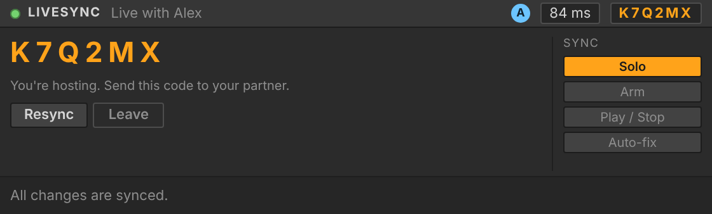

# LiveSync: work on one Ableton Live project together, from anywhere

LiveSync connects two (or more) copies of Ableton Live on different networks and keeps
their Live Sets in sync while you both work. Change the tempo, add a synth, draw notes,
tweak an EQ, record a vocal, and your partner sees it in their Live a moment later.



## How it fits together

```
 Live (you)                                       Live (partner)
 ┌───────────────────────────┐                    ┌───────────────────────────┐
 │ LiveSync Remote Script    │  wss://  ┌──────┐  │ LiveSync Remote Script    │
 │  - watches your set       │ ───────▶ │Relay │ ◀│  - applies your changes   │
 │  - applies partner edits  │ ◀─────── │server│ ─▶│  - sends theirs           │
 │ LiveSync panel (M4L/web)  │          └──────┘  │ LiveSync panel (M4L/web)  │
 └───────────────────────────┘                    └───────────────────────────┘
```

* **Remote Script** (`remote_script/LiveSync`) runs inside Live using Ableton's own Python
  API (the Live Object Model). Ableton doesn't offer a plugin SDK that can add menus to
  Live itself, so this is the supported way to read and change a Live Set.
* **Relay server** (`server/`) is a small WebSocket service. Both people connect *out* to it,
  so nobody needs port forwarding, a VPN or the same network. It puts every change in one
  global order, replays missed changes after a dropout, and passes audio files along.
* **Panel** is a compact screen styled like Live's devices. It appears inside Live through the
  LiveSync Max for Live device, and also at <http://127.0.0.1:47010> in any browser, so it
  works on Live editions without Max for Live too.

Works on **macOS and Windows**, Live **11.1 or newer** (Live 12 recommended; some features
need it, see [What syncs](docs/WHAT_SYNCS.md)).

## Set up (one time)

### 1. Run a relay server

Both of you must use the same server. Pick one:

* **Quick test (free, 2 minutes):** on one computer, install [Node.js](https://nodejs.org), then
  ```bash
  cd server && npm install && npm start            # relay on port 8787
  npx cloudflared tunnel --url http://localhost:8787
  ```
  cloudflared prints an address like `https://something.trycloudflare.com`. Your server
  address is the same with `wss://`: `wss://something.trycloudflare.com`. It changes every time
  you restart the tunnel.
* **Permanent:** deploy `server/` to any host that runs Docker and WebSockets. Fly.io
  (`server/fly.toml`) and Render (`render.yaml`, free plan) configs are included. Your address
  is then `wss://<your-app>.fly.dev` or `wss://<your-app>.onrender.com`.

### 2. Install LiveSync on each computer

* **macOS:** double-click `installer/install-mac.command`.
* **Windows:** double-click `installer\install-windows.bat`.

This copies the Remote Script and the panel device into your Ableton User Library. If you
moved your User Library, set the environment variable `LIVESYNC_USER_LIBRARY` to its path
first, or copy the two items by hand:

| Item | Copy to |
|---|---|
| `remote_script/LiveSync` folder | `User Library/Remote Scripts/LiveSync` |
| `m4l/LiveSync.amxd` | `User Library/Presets/Audio Effects/Max Audio Effect/` |

### 3. Turn it on in Live

1. Restart Live.
2. Open **Settings / Preferences › Link, Tempo & MIDI**. In an empty **Control Surface** slot
   choose **LiveSync**. Leave Input and Output set to None.
3. Drag **LiveSync** from *Audio Effects › Max Audio Effect* onto your **Master** track. If you
   don't have Max for Live, open <http://127.0.0.1:47010> in your browser instead.

## Using it

1. **Host:** open the project you want to share. In the panel, enter the server address and
   your name, then press **Host**. You get a six-letter code like `K7Q2MX`. Click it to copy
   and send it to your partner.
2. **Join:** open a **new, empty Live Set**, enter the same server address and the code, and
   press **Join**. LiveSync rebuilds the host's project in your set (tracks, devices, clips,
   notes, audio) with a progress bar while it works. Joining replaces what's in the set you
   join from.
3. Work. Both of you can edit anything at the same time. If you both move the same knob at
   the same moment, the last move to reach the server wins on both computers.

### When something goes wrong

LiveSync never throws error dialogs at you. Instead the panel tells you what's happening
and offers one button to fix it:

| You see | What it means | What to do |
|---|---|---|
| Yellow dot, "Reconnecting…" | Your internet dropped. Edits you make meanwhile are kept and sent when you're back. | Nothing. Press **Retry now** if it takes long. |
| Progress bar | Joining, resyncing, catching up, or transferring audio. | Wait for it to finish. |
| Red dot, "drifted apart" with **Fix it** | Both sets compare fingerprints every few seconds, and they differ. | Press **Fix it**. You get a fresh copy from the host. Turn on **Auto-fix** to do this automatically. |
| "…isn't installed on this computer" | Your partner used a plugin you don't have. | Install the same plugin (VST/VST3/AU are matched by name), then press **Resync**. |

Details for troubleshooting are logged to `Documents/LiveSync/livesync.log`.

### Options (shared by everyone in the session)

* **Solo**: share solo buttons (on by default).
* **Arm**: share record-arm buttons (off by default, since you usually record your own inputs).
* **Play / Stop**: start and stop playback together. Each computer plays its own audio,
  so this isn't sample-accurate jamming over the internet.
* **Auto-fix**: resync automatically when drift is detected, instead of asking.

## What syncs, and what Live doesn't allow

See **[docs/WHAT_SYNCS.md](docs/WHAT_SYNCS.md)**. In short: tempo, key and scale, time
signature, tracks, returns, scenes, mixer (volume, pan, sends, mute, solo), Live devices and
plugins and all their parameters, the master chain, session clips, MIDI notes (pitch, timing,
length, velocity, probability and more), clip automation, audio clips with their files (recorded
takes and imported or rendered samples), warp settings, and arrangement clips all sync.

A few things Live's API doesn't expose, so no Remote Script can sync them. The biggest are
arrangement automation lanes, MPE per-note pitch slides, plugin presets and internal state beyond
their exposed parameters, Rack chain contents and samples loaded inside instruments, and
UI-only actions such as Export Audio, Freeze and track reordering. The doc lists workarounds.

## For developers

```
remote_script/LiveSync/   Remote Script (pure Python stdlib; runs inside Live)
  surface.py              Live entry point (update_display tick → engine)
  engine.py               change detection, op ordering, conflicts, snapshots, drift hashes
  model.py                read/write the Live Object Model as plain JSON
  net.py                  dependency-free WebSocket client on a background thread
  files.py                audio fingerprinting + chunked upload/download
  ui.py, panel.html       local panel server and the panel page
server/src/server.js      relay (Node.js + ws)
m4l/build_device.py       generates LiveSync.amxd / LiveSync.maxpat
tests/                    end-to-end tests: two simulated Live sets through a real relay
```

Run the tests (needs Python 3 and Node.js):

```bash
cd server && npm install && cd ..
python3 -m unittest discover -s tests -v
```

The tests run the real engine, network client and relay against an in-memory imitation of
Live's API (`tests/fake_live.py`). They cover joining, song settings, tracks, scenes, mixer,
devices, plugins, parameters, clips, notes, audio file transfer, arrangement clips, clip
automation, simultaneous edits, drift detection and repair, and reconnecting. The real Live
API can still behave differently in edge cases, so check each release in Live itself.
